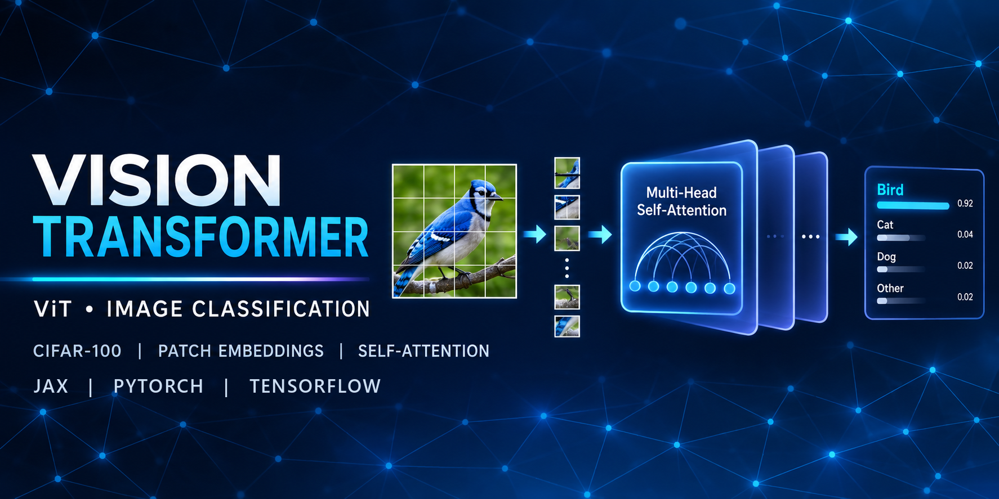
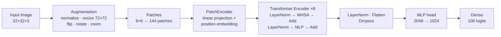

<p align="center">
  
</p>

<p align="center">
  
  
  
  
</p>

<p align="center">
  <a href="#overview">Overview</a> •
  <a href="#architecture">Architecture</a> •
  <a href="#getting-started">Getting Started</a> •
  <a href="#configuration">Configuration</a> •
  <a href="#project-structure">Project Structure</a> •
  <a href="#references">References</a>
</p>

---

## Overview

This repository contains a from-scratch implementation of the **Vision Transformer (ViT)** for image classification on the **CIFAR-100** dataset, written with **Keras 3**.

Instead of convolutions, ViT splits each image into a grid of fixed-size patches, linearly projects every patch into an embedding, adds a learned positional embedding, and feeds the resulting sequence through a stack of Transformer encoder blocks. Self-attention lets every patch attend to every other patch, so the model learns global relationships across the image from the very first layer.

**Highlights**

- Pure attention-based classifier — no convolutional layers
- Backend-agnostic: runs on **JAX**, **TensorFlow**, or **PyTorch** through Keras 3
- Modular layers (`Patches`, `PatchEncoder`, `mlp`) that are easy to reuse or extend
- Built-in data augmentation, AdamW optimisation, and best-checkpoint restoration
- Patch visualisation utility to inspect how images are tokenised

## Architecture



Each Transformer block follows the pre-norm design of the original paper:

| Step | Operation |
|------|-----------|
| 1 | Layer normalisation |
| 2 | Multi-head self-attention (4 heads, key dim 64, dropout 0.1) |
| 3 | Residual connection |
| 4 | Layer normalisation |
| 5 | MLP (128 → 64, GELU, dropout 0.1) |
| 6 | Residual connection |

> Unlike the original ViT, this implementation does not use a `[CLS]` token. The final encoded patch sequence is flattened and passed to the MLP classification head.

## Getting Started

### Prerequisites

- Python 3.9 or newer
- One Keras 3 backend: JAX, TensorFlow, or PyTorch
- A GPU is strongly recommended for full training runs

### Installation

```bash
git clone https://github.com/rezatorabi13/Vision-Transformer.git
cd Vision-Transformer

python -m venv .venv
source .venv/bin/activate        # Windows: .venv\Scripts\activate

pip install --upgrade keras numpy matplotlib
pip install --upgrade "jax[cpu]"  # or: tensorflow / torch (pick one backend)
```

### Training

```bash
python train.py
```

The script will:

1. Download CIFAR-100 automatically through `keras.datasets`
2. Adapt the normalisation layer to the training data
3. Build the ViT model and train it with AdamW (10% of training data held out for validation)
4. Restore the checkpoint with the best validation accuracy
5. Report **top-1** and **top-5** test accuracy
6. Plot the training and validation loss and top-5 accuracy curves

### Choosing a backend

JAX is the default. To use another backend, set the `KERAS_BACKEND` environment variable:

```bash
KERAS_BACKEND=tensorflow python train.py      # macOS / Linux
$env:KERAS_BACKEND="torch"; python train.py   # Windows PowerShell
```

Or change the default at the top of [`train.py`](train.py):

```python
os.environ.setdefault("KERAS_BACKEND", "jax")  # "tensorflow" | "jax" | "torch"
```

## Configuration

All hyperparameters are defined in [`train.py`](train.py):

| Parameter | Default | Description |
|-----------|---------|-------------|
| `learning_rate` | `0.001` | AdamW learning rate |
| `weight_decay` | `0.0001` | AdamW weight decay |
| `batch_size` | `256` | Training batch size |
| `num_epochs` | `10` | Training epochs (use `100` for a full run) |
| `image_size` | `72` | Images are resized to `image_size × image_size` |
| `patch_size` | `6` | Side length of each square patch |
| `num_patches` | `144` | `(image_size // patch_size) ** 2` |
| `projection_dim` | `64` | Patch embedding dimension |
| `num_heads` | `4` | Attention heads per Transformer block |
| `transformer_layers` | `8` | Number of Transformer encoder blocks |
| `transformer_units` | `[128, 64]` | Hidden sizes of the MLP inside each block |
| `mlp_head_units` | `[2048, 1024]` | Hidden sizes of the classification head |

## Results

The default `num_epochs = 10` is intended as a quick sanity check. For reference, the Keras example this project is based on reports roughly **55% top-1** and **82% top-5** test accuracy on CIFAR-100 after **100 epochs** with the same configuration.

ViTs are data-hungry; when trained from scratch on small datasets they typically trail CNNs of similar size. Accuracy can be improved by training longer, using larger models, applying stronger regularisation and augmentation, or fine-tuning a model pre-trained on a larger dataset.

## Project Structure

```text
Vision-Transformer/
├── assets/
│   └── banner.png        # Repository banner
├── train.py              # Entry point: data loading, config, training and evaluation
├── vit_model.py          # create_vit(): assembles the full ViT model
├── patches.py            # Patches layer: splits images into flattened patches
├── patch_encoder.py      # PatchEncoder layer: linear projection + position embedding
├── mlp.py                # mlp(): stacked Dense + GELU + Dropout blocks
├── plot_patches.py       # Utility to visualise an image and its extracted patches
└── ReadMe.md
```

## References

- A. Dosovitskiy et al., [*An Image is Worth 16x16 Words: Transformers for Image Recognition at Scale*](https://arxiv.org/abs/2010.11929), ICLR 2021.
- A. Vaswani et al., [*Attention Is All You Need*](https://arxiv.org/abs/1706.03762), NeurIPS 2017.
- Keras code example: [*Image classification with Vision Transformer*](https://keras.io/examples/vision/image_classification_with_vision_transformer/).
- A. Krizhevsky, [*Learning Multiple Layers of Features from Tiny Images*](https://www.cs.toronto.edu/~kriz/learning-features-2009-TR.pdf) (CIFAR-100), 2009.

## Acknowledgements

This implementation is adapted from the official Keras example by Khalid Salama and restructured into reusable modules.
